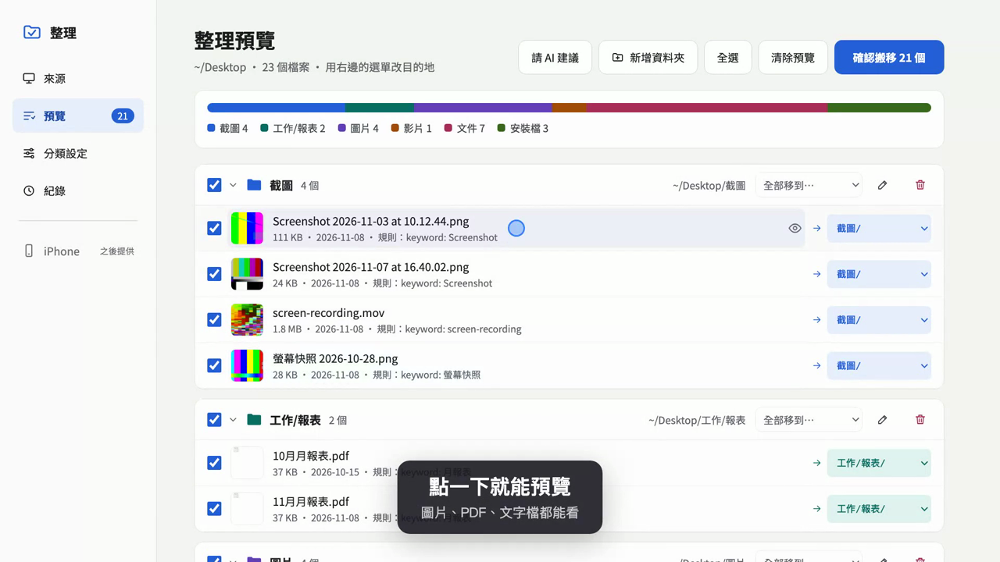
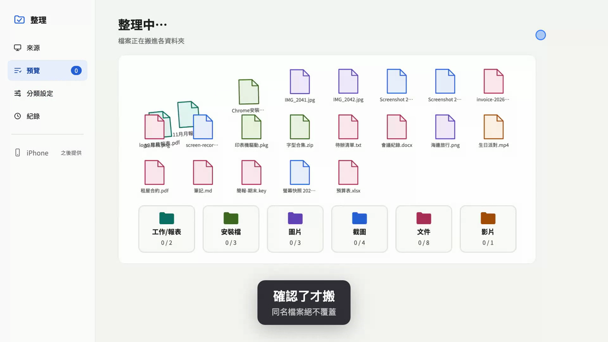

# folder-tidy

把 Mac 上亂掉的資料夾（桌面、下載、iCloud Drive）依規則整理進分類資料夾：先預覽，確認後才搬，搬錯可以復原。

Organize a messy Mac folder into category folders by rules. You always see
the plan first, nothing moves until you confirm, and every move can be
undone. The UI is in Traditional Chinese.





## 功能

- **規則分類**：依副檔名、檔名關鍵字、修改日期（固定日期區間，或「最近 N 天內」「超過 N 天」）分類。分類就是目標資料夾，可以多層（`工作/報表`）。規則由上到下比對，第一個符合的分類勝出。
- **整理預覽**：檔案依目的地分組，附 Quick Look 縮圖；點檔名可開啟預覽（Quick Look 縮圖，純文字檔顯示開頭幾行）。
- **手動調整**：用選單改單一檔案的目的地（或設成「不搬」）、勾選或取消、整組移到別的資料夾、新增 / 重新命名 / 刪除資料夾。
- **記住**：把手動指定的分類變成關鍵字規則，下次同類檔名自動分到同一個資料夾。
- **安全搬移**：確認後才搬，絕不覆蓋既有檔案；目的地已有同名檔案的會跳過並列出來。
- **紀錄與復原**：每次搬移都寫進搬移紀錄（JSON），可以一鍵把最近一次整理的檔案放回原位。
- **AI 建議（選用）**：規則都抓不到的檔案，可以交給你本機已登入的 [Claude Code](https://claude.com/claude-code) CLI 建議分類。只送檔名、大小、日期，不送檔案內容；列在 `ai_exclude` 的資料夾與副檔名完全不會送出。
- **只在本機執行**：網頁介面只綁 `127.0.0.1`，其他主機名稱的請求一律拒絕。

## 系統需求

- macOS（使用 `renamex_np`、Quick Look 的 `qlmanage`、`osascript` 資料夾選擇視窗）
- 從原始碼編譯才需要：Rust 1.85 以上（edition 2024）
- 選用：已登入的 `claude` CLI，用於 AI 建議

## 安裝

### 用 Homebrew（建議）

```sh
brew install rosehsu47/tap/folder-tidy
```

Homebrew 會從這個 repo 公開的原始碼現場編譯（自動裝好 Rust），不會下載預先編譯好的執行檔。需要最新版的 Xcode Command Line Tools；太舊的話 Homebrew 會直接拒絕安裝，並告訴你怎麼更新。

目前不提供預先編譯的下載檔：執行檔沒有經過 Apple 公證，要用的話必須關掉 macOS 的安全檢查，所以寧可請你從原始碼編譯。

### 從原始碼編譯

需要 Rust 1.85 以上：

```sh
git clone https://github.com/rosehsu47/folder-tidy.git
cd folder-tidy
cargo build --release
```

執行檔在 `./target/release/folder-tidy`。下面的指令都寫成 `folder-tidy`，從原始碼編譯的話換成 `./target/release/folder-tidy`。

## 開始使用

### 1. 建立規則檔

規則檔必須先存在（`serve` 讀不到檔案會直接報錯）。網頁介面裡改的設定會存回這個檔案。放哪裡都可以，以下用 `~/.config/folder-tidy/`：

```sh
mkdir -p ~/.config/folder-tidy
cat > ~/.config/folder-tidy/rules.toml <<'TOML'
ai_exclude = ["~/Documents/tax", "*.key"]

[[category]]
name = "截圖"
keywords = ["Screenshot", "螢幕快照"]

[[category]]
name = "工作/報表"
keywords = ["月報表"]

[[category]]
name = "圖片"
extensions = ["jpg", "png", "heic"]

[[category]]
name = "文件"
extensions = ["pdf", "docx", "xlsx"]

[[category]]
name = "安裝檔"
extensions = ["dmg", "pkg", "zip"]
TOML
```

完整格式見下方〈規則檔格式〉。

### 2. 啟動網頁介面

```sh
folder-tidy serve --config ~/.config/folder-tidy/rules.toml --log ~/.config/folder-tidy/moves.json
```

打開 <http://127.0.0.1:8737/>。

- `--log`：搬移紀錄檔，第一次整理時會自動建立。
- `--port`：換連接埠，預設 `8737`。
- 按 Ctrl-C 停止。

## 網頁介面用法

1. **來源**：選桌面、下載或 iCloud Drive，或輸入任一資料夾路徑（可用 `~/`），也可以按「選擇…」用 Mac 視窗挑。勾「包含子資料夾」會連子資料夾一起掃。按**掃描**，掃描只讀取檔名與屬性，不會搬動任何檔案。
2. **預覽**：檢查整理計畫。
   - 用每個檔案右邊的選單改目的地，或取消勾選讓它留在原地。
   - 手動改過的檔案可以按「記住」，把檔名裡的關鍵字加進該分類的規則。
   - 規則都抓不到的檔案，可以按「請 AI 建議」。AI 建議預設不勾選，要你自己勾。
   - 按**確認搬移**才會真的搬。
3. **分類設定**：新增或刪除分類，編輯副檔名、檔名關鍵字（可暫時停用）、修改日期條件，以及「不送給 AI」清單。設定會存回規則檔。
4. **紀錄**：列出每次整理，可以從最近一次開始復原。

## 規則檔格式

```toml
# 不送給 AI 的項目（選用）
ai_exclude = ["~/Documents/tax", "private", "*.key"]

[[category]]
name = "工作/報表"             # 分類名稱 = 目標資料夾，可用 / 建多層
extensions = ["pdf"]           # 副檔名，不含點，不分大小寫
keywords = ["月報表"]           # 檔名包含這些字就符合，不分大小寫
disabled_keywords = ["草稿"]    # 暫時停用的關鍵字：保留但不比對

[[category]]
name = "舊檔案"
date = { before = "2025-01-01" }          # 修改日期早於（不含）

[[category]]
name = "本週"
date = { newer_than_days = 7 }            # 最近 7 天內修改
```

**比對規則**

- 分類內的副檔名、關鍵字、日期，任一條符合就算符合。
- 分類由上到下比對，第一個符合的勝出。
- 什麼規則都沒有的分類不會自動比對到任何檔案，只能手動把檔案指定過去。

**日期條件**（`date`）

| 欄位 | 意思 |
|---|---|
| `after = "YYYY-MM-DD"` | 修改日期在這天當天或之後 |
| `before = "YYYY-MM-DD"` | 修改日期在這天之前（不含） |
| `newer_than_days = N` | 從掃描當天往回算 N 天內修改 |
| `older_than_days = N` | 超過 N 天前修改 |

- 固定日期（`after` / `before`）和相對天數（`*_days`）不能混用。
- 至少要設一個欄位。

**`ai_exclude`**

| 寫法 | 排除的檔案 |
|---|---|
| `*.key`、`*.tar.gz` | 檔名以該副檔名結尾（不分大小寫） |
| `~/dir`、`/abs/dir` | 在那個資料夾裡的所有檔案 |
| `dir`、`a/b` | 掃描資料夾底下的路徑中，依序出現這些資料夾名稱的檔案（例如 `tax` 會排除 `tax/x` 和 `2024/tax/y`） |

**規則檔會被拒絕的情況**：分類名稱重複、分類名稱是空的、含 `\`、某一段是 `.` 或 `..`、或有空的路徑段（開頭、結尾或連續的 `/`）；副檔名或關鍵字是空的；同一個關鍵字同時出現在 `keywords` 和 `disabled_keywords`。

## AI 建議（選用）

- 會呼叫本機的 `claude -p`，用你的 Claude Code 訂閱額度，不需要 API key。
- CLI 執行時關掉所有工具和 MCP 伺服器，AI 只能回答，不能讀檔或動檔。
- 送出的資料：檔案相對於掃描資料夾的路徑、大小、修改日期。不會讀取或送出檔案內容。
- 每批最多 100 個檔案。任何一批失敗，整次建議就失敗並顯示錯誤，不會只回傳一部分。

## 命令列

不開網頁介面，也可以直接用指令：

```sh
folder-tidy scan  ~/Desktop --config ~/.config/folder-tidy/rules.toml  # 每個檔案的分類（JSON），不搬
folder-tidy plan  ~/Desktop --config ~/.config/folder-tidy/rules.toml  # 預演搬移計畫（JSON），不搬
folder-tidy apply ~/Desktop --config ~/.config/folder-tidy/rules.toml --log ~/.config/folder-tidy/moves.json --yes  # 真的搬
folder-tidy undo  --log ~/.config/folder-tidy/moves.json  # 復原最近一次 apply
```

- `scan`、`plan`、`apply` 加 `--recursive` 會包含子資料夾。
- `apply` 不加 `--yes` 不會搬任何檔案。
- `undo` 一次復原一批，從最近一次開始，復原後該批會從紀錄裡移除。搬到一半中斷的 apply 也能復原，因為每搬一個檔案就寫一次紀錄。

**結束碼**

| 結束碼 | 意思 |
|---|---|
| `0` | 成功 |
| `1` | 錯誤（例如規則檔有誤、資料夾不存在、`apply` 沒加 `--yes`） |
| `2` | 部分完成：`apply` 有檔案因同名而跳過，或 `undo` 有檔案搬不回去（這些會留在紀錄裡） |

## 測試

```sh
cargo test
```

測試只在暫存資料夾和測試用檔案上跑，不會動到你的檔案，不會呼叫真的 `claude` CLI，也不會開資料夾選擇視窗。

## License

MIT
